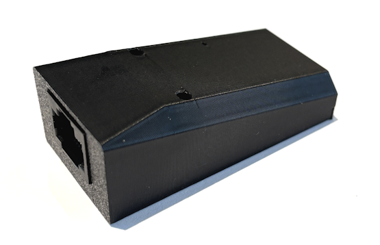
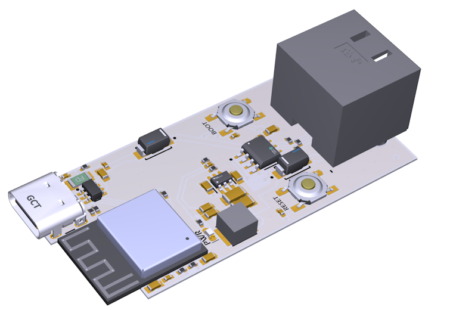
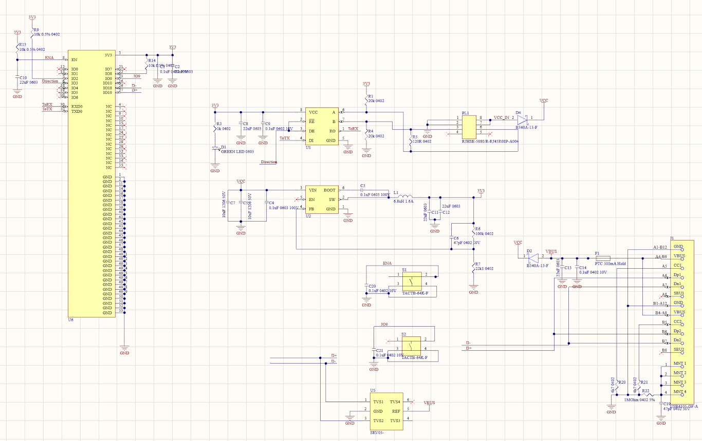
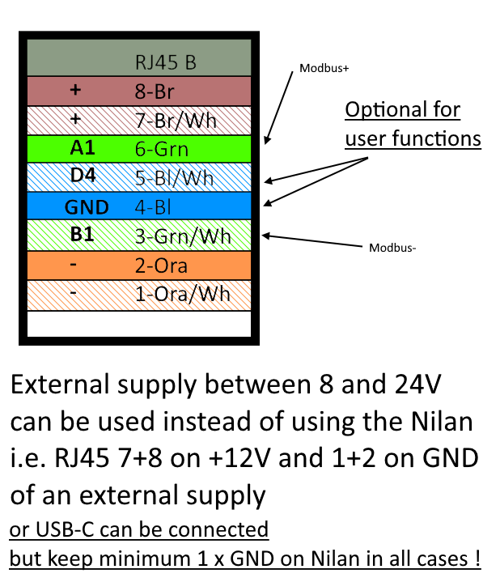
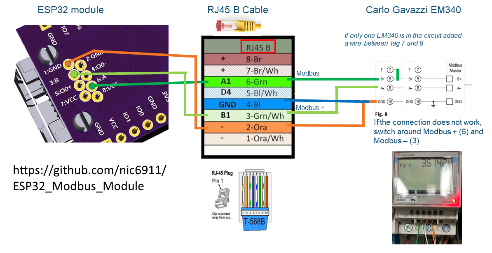
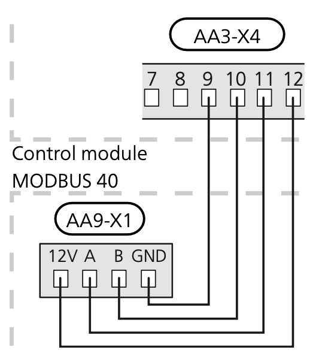

# ESP32 Modbus Module

## Overview

The ESP32 Modbus module is designed for integrating Modbus-enabled devices with Home Assistant. It supports various devices including:

- **Nilan Ventilation** (CTS602/602Light and CTS400 with Modbus)
- **Wavin AHC9000** (Floor heating)
- **Wavin Sentio** (Floor heating)
- **EM340** (Electricity meter with Modbus)
- **NIBE F1255** (Heatpump)

The module is flexible and can be adapted for other Modbus applications, although no promises are made for unsupported devices.

[Buy the module here](https://www.ustepper.com/shop/#!/products/esphome-modbus-module)

---

## Disclaimer

**Use at your own risk!** Improper connections could potentially damage hardware. The hardware and software have been tested with the listed devices without issues.

---

## Features

- Modbus communication with popular home automation systems (e.g., **Home Assistant**, **ESPHome**).
- Supports multiple devices (Nilan, Wavin, EM340, NIBE, and more).
- Provides wiring and software guides to get started quickly.

---

## Rev2 hardware

The 2 x optocoupler outputs have been removed (legacy functionality), the 2 x pin
rows are gone, and the flow-control pin is GPIO3.

The Rev2 code is here: [rev2](esphome_example_code/rev2)

Using the older Rev1 board? The Rev1 example code (flow-control pin `GPIO10`) is still available in [esphome_example_code/rev1](esphome_example_code/rev1).







## Wavin AHC9000 automatic zones

For the Wavin AHC9000, use the ready-made automatic-zone configuration for the
Rev2 module:

**[ahc9000_v4_auto.yaml](esphome_example_code/rev2/ahc9000_v4_auto.yaml)**

This YAML sets up the `wavinahc9000v4` ESPHome component, automatic zone
discovery, and the services required by the companion Home Assistant
integration. It is already configured for the Rev2 flow-control pin (`GPIO3`).

1. Wire the AHC9000 to the module as described in
   [Connecting the Module](#connecting-the-module).
2. Flash `ahc9000_v4_auto.yaml` with ESPHome.
3. Install the
   **[Wavin Floor Heating integration](https://github.com/nic6911/ha-wavin-floor-heating)**.
   Home Assistant normally discovers the module automatically, so no IP address
   is required.

Component documentation and all YAML options:
**[Wavin AHC9000 V4 setup](https://github.com/heinekmadsen/esphome_components/blob/main/components/wavinahc9000v4/README.md)**

## Wavin Sentio automatic rooms

For the Wavin Sentio, use the automatic room-discovery configuration:

Configuration: **[WavinSentioV2_example.yaml](esphome_example_code/rev2/WavinSentioV2_example.yaml)**

It uses the `sentiov2` component and publishes a topology text sensor for the
same Home Assistant integration. Install the
**[Wavin Floor Heating integration](https://github.com/nic6911/ha-wavin-floor-heating)**
after flashing.

Component documentation and YAML options:
**[Wavin Sentio V2 setup](https://github.com/heinekmadsen/esphome_components/blob/main/components/sentiov2/README.md)**

## Nilan ventilation automatic detection

For Nilan CTS602, CTS602 Light and CTS400 ventilation units, use the
automatic detection and commissioning configuration.

**Wiring:** the module's RJ45 socket is **not** wired like a Nilan RJ45 port. For
the exact cable and pinout for the Rev2 module, see the dedicated
**[Nilan connection guide](docs/nilan-connection-guide.md)**.

Configuration: **[nilan_ventilation_auto.yaml](esphome_example_code/rev2/nilan_ventilation_auto.yaml)**

The firmware detects the controller, model and capabilities, prunes registers the
unit does not support and publishes topology/values/status for the companion
Home Assistant integration. The Nilan bus runs at `19200` baud, 8 data bits, even
parity, 1 stop bit and Modbus address `30`.

Install the
**[Nilan Ventilation integration](https://github.com/nic6911/ha-nilan-ventilation)**
after flashing. Home Assistant normally discovers the module automatically, so
no IP address is required.

Component documentation and YAML options (currently on the testing branch):
**[auto_nilan setup](https://github.com/nic6911/esphome_components/blob/feature/nilan_auto_discovery/components/auto_nilan/README.md)**

The older manual examples (`nilan602.yaml`, `Nilan_cts400.yaml`,
`Nilan_example.yaml`) remain for legacy setups.

## Connecting the Module

### General connector layout

The module's RJ45 socket uses the Wavin pinout:

| Pin | Function |
|---|---|
| 1, 2 | GND |
| 3 | B (Modbus−) |
| 4, 5 | not used |
| 6 | A (Modbus+) |
| 7, 8 | +12 V input (5–24 V DC) |

Power the module with **USB-C**, or with **5–24 V DC** on pins 7/8. Do not use both at the same time.



### Compatibility notes

| Device | Connection |
|---|---|
| Wavin AHC9000 / Sentio | Straight RJ45 patch cable. The Wavin display must be disconnected because it is also a Modbus master. |
| Nilan CTS400 / CTS602 / CTS602 Light | The module's RJ45 is **not** the Nilan pinout. Use the **[Nilan connection guide](docs/nilan-connection-guide.md)**. |
| EM340 | Connect A/B/GND as shown below. |
| Nibe F1255 | Connect A/B/GND as shown below. |

### Wavin AHC9000 / Sentio

Use a **straight RJ45 patch cable** between the Wavin Modbus port and the module.

> **Only one Modbus master is allowed on the bus.** Disconnect the Wavin display/controller before connecting the module, because the display also acts as a Modbus master. The module must be the only master.

For the ready-made configurations, see [Wavin AHC9000 automatic zones](#wavin-ahc9000-automatic-zones) and [Wavin Sentio automatic rooms](#wavin-sentio-automatic-rooms).

### Nilan

The module's RJ45 socket is **not** wired like a Nilan RJ45 port. A straight patch cable will **not** work. Use the dedicated **[Nilan connection guide](docs/nilan-connection-guide.md)** for the exact cable and pinout for CTS400, CTS602 and CTS602 Light.

### EM340

A wiring example on an EM340 Modbus power meter:



### Nibe F1255

A Nibe heat pump Modbus interface:



---

## Software Guides

### Installation & Setup

- **Home Assistant & ESPHome**: The module integrates seamlessly with these platforms.
- [Video Guide: USB + WiFi Upload for AHC9000](https://youtu.be/jKOnhiWMCx8)

### Example Code

You can find example code for **Nilan**, **Nibe**, **EM340**, and more in the code folder. A generic setup for **Nilan** is available [here](https://github.com/Jopand/esphome_components/blob/main/README.md).

Example configuration for **Nilan**:

```
esphome:
  name: nilan
esp32:
  board: esp32-c3-devkitm-1
  framework:
    type: arduino

wifi:
  ssid: !secret wifi_ssid
  password: !secret wifi_password
  output_power: "8.5"

uart:
  rx_pin: 20
  tx_pin: 21
  parity: EVEN
  baud_rate: 19200
  id: uart_modbus
  stop_bits: 1
  
modbus:
  id: modbus_id
  flow_control_pin: 10
  uart_id: uart_modbus

```

