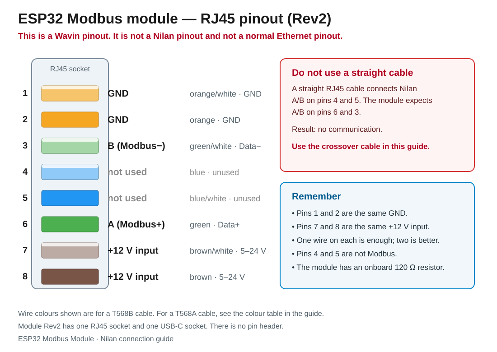
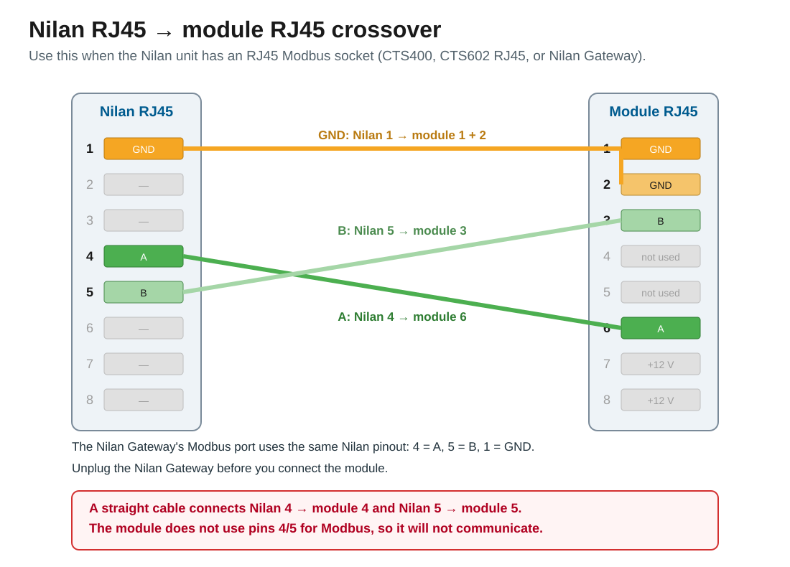
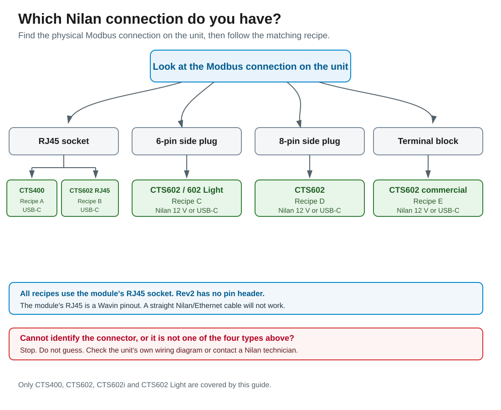
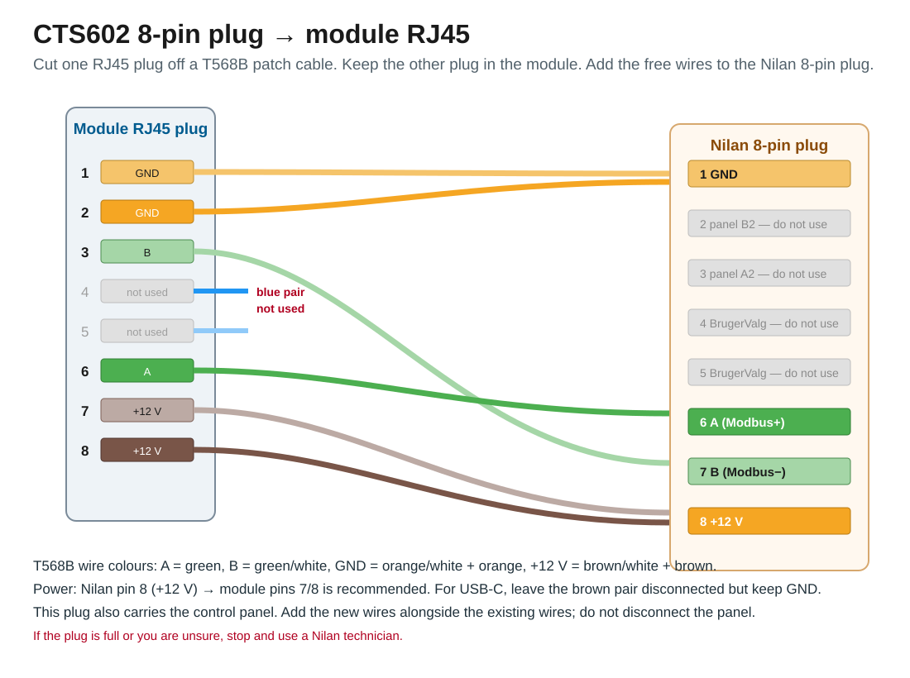

# Connecting a Nilan ventilation unit to the ESP32 Modbus module

This guide is for the **Rev2 ESP32 Modbus module** (the board with **one RJ45 socket and one USB-C socket**, and no pin header).

It covers:

- **Nilan CTS400**
- **Nilan CTS602 / CTS602i**
- **Nilan CTS602 Light**

The guide is written for someone who is comfortable cutting and stripping a low-voltage cable, but is **not** an electrician. Work on the **low-voltage Modbus side only**.

> **Warning:** The Nilan unit contains 230 VAC. Disconnect the mains supply before you open the unit or work near its control board. If you are unsure, stop and use a Nilan technician or an electrician.

---

## Quick start

| If your Nilan unit has... | Use recipe | Power the module with | Firmware |
|---|---|---|---|
| CTS400 with an RJ45 Modbus socket | [Recipe A](#5-recipe-a--cts400-rj45) | USB-C | `nilan_ventilation_auto.yaml` (or legacy `Nilan_cts400.yaml`) |
| CTS602 with an RJ45 outlet | [Recipe B](#6-recipe-b--cts602-with-rj45-outlet) | USB-C | `nilan_ventilation_auto.yaml` |
| CTS602 / CTS602 Light with a 6-pin side plug | [Recipe C](#7-recipe-c--cts602--cts602-light-6-pin-plug) | Nilan 12 V (recommended) or USB-C | `nilan_ventilation_auto.yaml` |
| CTS602 with an 8-pin side plug | [Recipe D](#8-recipe-d--cts602-8-pin-plug) | Nilan 12 V (recommended) or USB-C | `nilan_ventilation_auto.yaml` |
| CTS602 commercial unit with a terminal block | [Recipe E](#9-recipe-e--cts602-terminal-block--direct-to-cn7) | Nilan 12 V (recommended) or USB-C | `nilan_ventilation_auto.yaml` |
| Anything else | Stop | — | — |

> **The single most important thing:** the module's RJ45 socket is **not** a Nilan pinout and **not** a normal Ethernet pinout. It is wired for Wavin AHC9000/Sentio. A straight RJ45 patch cable between a Nilan RJ45 port and the module will **not work**. You must make the cable described in this guide.

---

## 1. Before you start

### The module is a Modbus master

The module talks to the Nilan unit as a **Modbus master**. The Nilan MB Gateway is also a master. Therefore:

- Unplug the Nilan MB Gateway before you connect the module.
- Never connect the module and the Nilan Gateway to the same Modbus bus at the same time.

The module does **not** replace the Nilan cloud app. It gives you local Modbus access for Home Assistant/ESPHome.

### Rev2 has only one Modbus connection

The Rev2 module has:

- one **RJ45** socket (Modbus + power input)
- one **USB-C** socket (power and flashing)

The older Rev1 board had a 2×4 pin header. **This guide does not use that header**, and it does not apply to Rev1.

### Tools

- Side cutters and wire strippers
- RJ45 crimping tool and a few RJ45 plugs (for the CTS400/CTS602 RJ45 recipes)
- A multimeter
- Small screwdriver for the Nilan plug
- Small Wago connectors or ferrules (optional, for joining wires)
- A standard Cat5/Cat6 patch cable

### Choose one cable standard

The module's RJ45 pin **numbers** are fixed. The **wire colours** depend on whether your patch cable is wired to **T568B** (most common) or **T568A**.

This guide uses **T568B** in all examples. If your cable is T568A, use the conversion table in [section 10](#10-t568a-and-t568b-colours).

> **Tip:** You can identify the cable by looking at the plug. With the clip away from you and the contacts up, **T568B starts with orange/white on the left**; **T568A starts with green/white on the left**.

---

## 2. The module RJ45 pinout



| Module RJ45 pin | Function | T568B wire | Notes |
|---|---|---|---|
| 1 | GND | orange/white | Connect to Nilan GND |
| 2 | GND | orange | Same GND as pin 1 |
| 3 | B (Modbus−) | green/white | Nilan Data− / B |
| 4 | not used | blue | Do not use |
| 5 | not used | blue/white | Do not use |
| 6 | A (Modbus+) | green | Nilan Data+ / A |
| 7 | +12 V input | brown/white | 5–24 V DC input |
| 8 | +12 V input | brown | Same input as pin 7 |

Important:

- **Pins 1 and 2 are both GND.** One wire is enough; two is better.
- **Pins 7 and 8 are both +12 V input.** One wire is enough; two is better.
- **Pins 4 and 5 are not Modbus.** They are reserved for other module functions and must be left alone.
- The module can be powered by **USB-C** or by **5–24 V DC** on pins 7/8. Do not use both at the same time.
- The module has an onboard **120 Ω** termination resistor.

> Some older documentation calls the module's socket **"RJ45 B"**. That is a Wavin designation, not the T568B cable standard. The pin numbers in this guide are what matter.

---

## 3. The Nilan RJ45 pinout

Nilan uses the same RJ45 pinout on:

- the CTS400 Modbus socket
- the CTS602 RJ45 outlet
- the **Modbus port of the Nilan MB Gateway**

| Nilan RJ45 pin | Function |
|---|---|
| 1 | GND |
| 4 | A (Modbus+) |
| 5 | B (Modbus−) |

Nilan's own gateway cable is normally a **T568A** cable. In Nilan's drawings the colours are therefore:

- blue = Modbus+
- blue/white = Modbus−
- green/white = GND

**Do not copy Nilan's colours directly to the module.** The module uses different pins. Use the pin numbers in this guide.

> The word **crossover** in this guide means the pin mapping between the Nilan connector and the module. It is **not** a standard Ethernet crossover cable (which swaps pins 1↔3 and 2↔6). Do not use a standard Ethernet crossover cable.



---

## 4. Identify your unit



Look at the Modbus connection on your unit:

1. **RJ45 socket on the unit** → Recipe A (CTS400) or Recipe B (CTS602 RJ45 outlet).
2. **6-pin plug on the side** → Recipe C.
3. **8-pin plug on the side** → Recipe D.
4. **Terminal block / commercial unit** → Recipe E.
5. **Only a Nilan Gateway or BACnet** → the unit may still have a Modbus port; find the port in the unit's own wiring diagram. If you cannot identify it, stop.

> **Warning:** Do not guess. The side connectors also carry the control panel and 12 V. Connecting the wrong wire can damage the module or the unit.

---

## 5. Recipe A — CTS400 RJ45

### What you need

- CTS400 with an RJ45 Modbus socket.
- A **custom RJ45-to-RJ45 cable** (two plugs).
- USB-C power supply for the module.

### Pinout

| Nilan RJ45 | Function | Module RJ45 | T568B wire at the module plug |
|---|---|---|---|
| 4 | A (Modbus+) | 6 | green |
| 5 | B (Modbus−) | 3 | green/white |
| 1 | GND | 1 and 2 | orange/white (and orange) |
| — | — | 7/8 | leave unconnected |

### How to make the cable

1. Start with a straight-through Cat5/Cat6 patch cable that is long enough.
2. Cut off **one** plug.
3. Crimp a **new RJ45 plug** on the cut end, but do **not** use the normal colour order. Use this order for the **Nilan end**:

| Nilan plug pin | Wire (T568B cable) |
|---|---|
| 1 | orange/white |
| 2 | not connected |
| 3 | not connected |
| 4 | green |
| 5 | green/white |
| 6 | not connected |
| 7 | not connected |
| 8 | not connected |

> Use **one** GND wire on Nilan pin 1. The module's pins 1 and 2 are the same GND, so one wire is enough. If you want to use the orange wire too, splice it to the same Nilan pin 1 with a Wago. Do **not** connect it to Nilan pin 2.

**If your cable is T568A**, use this Nilan plug order instead:

| Nilan plug pin | Wire (T568A cable) |
|---|---|
| 1 | green/white |
| 4 | orange |
| 5 | orange/white |
| 2, 3, 6, 7, 8 | not connected |

Cut the unused wires short so they cannot touch anything inside the plug.

4. The **other end** stays as the original plug (T568B or T568A) and goes into the module.
5. Plug the new end into the CTS400 Modbus socket.
6. Power the module with **USB-C**.

> **This is a crossover cable.** Do not use a normal patch cable. A normal cable puts Nilan A/B on pins 4/5, where the module expects nothing.

### Power

- **USB-C only.**
- The CTS400 Modbus RJ45 does not provide 12 V.
- You must still connect the **GND** wire between Nilan pin 1 and module pins 1/2. USB-C power alone does **not** give the module and the Nilan unit a common ground.

### Firmware

Use `esphome_example_code/rev2/nilan_ventilation_auto.yaml` (recommended).
The older `esphome_example_code/rev2/Nilan_cts400.yaml` is a legacy alternative
with explicit registers.

Settings:

- 19200 baud, 8 data bits, even parity, 1 stop bit (default)
- address 30
- `flow_control_pin: GPIO3`

If your CTS400 has been changed to 9600 baud, change the YAML to `baud_rate: 9600`.

---

## 6. Recipe B — CTS602 with RJ45 outlet

This is the same cable as Recipe A.

| Nilan RJ45 | Function | Module RJ45 | T568B wire at the module plug |
|---|---|---|---|
| 4 | A (Modbus+) | 6 | green |
| 5 | B (Modbus−) | 3 | green/white |
| 1 | GND | 1 and 2 | orange/white (and orange) |

Power: **USB-C**, and still connect the GND wire.

> Power the module with USB-C. Do not assume the CTS602 RJ45 outlet provides 12 V.

Firmware: `esphome_example_code/rev2/nilan_ventilation_auto.yaml`.

---

## 7. Recipe C — CTS602 / CTS602 Light 6-pin plug

This is the older 6-pin connector on the side of the unit, and the CN7 connector on the control board.

Pin 1 is marked on the plug. On the CN7 header, pin 1 is the +12 V pin at the end.

### Nilan pins

The table and drawing show the pin functions, not the physical layout. Follow the numbers moulded on the plug.

| Nilan pin | Function |
|---|---|
| 1 | +12 V DC output |
| 2 | A (Modbus+) / COM1 A1 |
| 3 | B (Modbus−) / COM1 B1 |
| 4 | User panel A2 (do not use) |
| 5 | User panel B2 (do not use) |
| 6 | GND |


### Wiring with a cut patch cable (T568B)

Cut one end off a T568B patch cable. Keep the original plug in the module. Connect the free wires to the Nilan plug:

| Nilan pin | Function | Module pin | Wire (T568B) |
|---|---|---|---|
| 2 | A | 6 | green |
| 3 | B | 3 | green/white |
| 6 | GND | 1 and 2 | orange/white and orange |
| 1 | +12 V | 7 and 8 | brown/white and brown |

The blue and blue/white wires are not used. Cut them short and insulate them.

> If the Nilan plug only accepts one wire per pin, join the two GND wires and the two +12 V wires with small Wago connectors first.

> **Warning:** Pins 4 and 5 are the control panel. Do not remove or move the existing panel wires. Add the new wires alongside them.

### Power

**Recommended:** power the module from the Nilan 12 V output.

- Nilan pin 1 (+12 V) → module pins 7 and 8 (brown/white and brown)
- Nilan pin 6 (GND) → module pins 1 and 2 (orange/white and orange)

**Alternative:** power the module with USB-C. Then leave the brown pair unconnected, but **still connect GND**.

> If the module resets or the WiFi drops when the ventilation unit starts, the Nilan 12 V output may be too weak. Use USB-C instead.

### Firmware

Use `esphome_example_code/rev2/nilan_ventilation_auto.yaml`.

Settings:

- 19200 baud, 8 data bits, even parity, 1 stop bit
- address 30
- `flow_control_pin: GPIO3`

---

## 8. Recipe D — CTS602 8-pin plug

Some CTS602 units use an 8-pin plug for the control panel. The Modbus wires share this plug.

### Nilan pins

The table and drawing show the pin functions, not the physical layout. Follow the numbers moulded on the plug.

| Nilan pin | Function |
|---|---|
| 1 | GND |
| 2 | Panel B2 (do not use) |
| 3 | Panel A2 (do not use) |
| 4 | BrugerValg (do not use) |
| 5 | BrugerValg (do not use) |
| 6 | A (Modbus+) / A1 |
| 7 | B (Modbus−) / B1 |
| 8 | +12 V DC output |

Pin 1 is marked on the plug; the numbers are usually moulded into the plastic. On the Nilan plug shown in Nilan's gateway manual, the pins run **8 to 1 from left to right**.



### Wiring with a cut patch cable (T568B)

| Nilan pin | Function | Module pin | Wire (T568B) |
|---|---|---|---|
| 6 | A | 6 | green |
| 7 | B | 3 | green/white |
| 1 | GND | 1 and 2 | orange/white and orange |
| 8 | +12 V | 7 and 8 | brown/white and brown |

The blue and blue/white wires are not used.

> If the Nilan plug only accepts one wire per pin, join the two GND wires and the two +12 V wires with small Wago connectors first.

> **Warning:** This plug also carries the control panel. Add the new wires alongside the existing wires. Do not disconnect the panel.

### Power

**Recommended:** Nilan pin 8 (+12 V) → module pins 7/8, and Nilan pin 1 (GND) → module pins 1/2.

**Alternative:** USB-C, with GND still connected.

Firmware: `esphome_example_code/rev2/nilan_ventilation_auto.yaml`.

---

## 9. Recipe E — CTS602 terminal block / direct to CN7

Some commercial units have a terminal box, and some technicians connect directly to the CN7 connector on the control board.

The pins are the same as the 6-pin recipe:

| Nilan pin | Function | Module pin | Wire (T568B) |
|---|---|---|---|
| 2 | A (A1) | 6 | green |
| 3 | B (B1) | 3 | green/white |
| 6 | GND | 1 and 2 | orange/white and orange |
| 1 | +12 V | 7 and 8 | brown/white and brown |


> **Warning:** Opening the unit exposes 230 VAC. Use a Nilan technician if you are not qualified.

---

## 10. T568A and T568B colours


The module's pin numbers do not change. Only the wire colours change.

| Module pin | Function | T568B wire | T568A wire |
|---|---|---|---|
| 1 | GND | orange/white | green/white |
| 2 | GND | orange | green |
| 3 | B (Modbus−) | green/white | orange/white |
| 6 | A (Modbus+) | green | orange |
| 7 | +12 V | brown/white | brown/white |
| 8 | +12 V | brown | brown |
| 4, 5 | not used | blue, blue/white | blue, blue/white |

So if your cable is T568A, the 6-pin recipe becomes:

| Nilan pin | Function | Module pin | T568A wire |
|---|---|---|---|
| 2 | A | 6 | orange |
| 3 | B | 3 | orange/white |
| 6 | GND | 1 and 2 | green/white and green |
| 1 | +12 V | 7 and 8 | brown/white and brown |

The same T568A conversion applies to the 8-pin and terminal-block recipes.

---

## 11. Power


| Unit | Recommended power | Alternative |
|---|---|---|
| CTS400 RJ45 | USB-C | — |
| CTS602 RJ45 outlet | USB-C | — |
| CTS602 6-pin | Nilan pin 1 → module 7/8 | USB-C |
| CTS602 8-pin | Nilan pin 8 → module 7/8 | USB-C |
| CTS602 terminal block | Nilan pin 1 → module 7/8 | USB-C |

Rules:

- Use **one** power source at a time.
- Never connect 12 V to A or B.
- Always connect **GND** between the Nilan unit and the module, even when the module is powered by USB-C.
- The module accepts **5–24 V DC** on pins 7/8.
- If the module behaves strangely, use USB-C and a good 5 V charger.

---

## 12. Cable and termination

- Use a **twisted pair** for A and B. In a T568B cable, the green pair is used for A/B.
- Keep the cable short. Nilan specifies a maximum of **20 m** for its gateway cable. RS485 can go further, but shorter is better.
- The module has an onboard **120 Ω** termination resistor. Do not add another resistor at the module end.
- For a short point-to-point cable, the module's termination is normally enough. If you have a long bus or unstable communication, a 120 Ω resistor may be needed at the Nilan end. Ask a technician.
- Do not run the Modbus cable parallel to mains cables for long distances.
- A shielded cable is not required for the short Nilan connection. If you use a shield, connect it at one end only.

---

## 13. Which Nilan units are supported?

Nilan publishes a compatibility table for its own MB Gateway. Use it as a guide for the minimum software version. Your unit must be at or above the version in the table.

| Unit type | CTS400 | CTS602 / CTS602i | CTS602 / CTS602i | CTS602 Light |
|---|---|---|---|---|
| All Comfort residential ventilation units | SW 1.0 or newer | SW 2.24 or newer | SW 1.6.6.0 or newer | SW 1.1.15.0 or newer |
| All other residential units with heat pumps | Not available | SW 2.38r or newer | SW 1.6.45.0 or newer | Not available |
| All Comfort commercial units | Not available | SW 2.38r or newer | SW 1.6.45.0 or newer | Not available |
| All VPM/VPL commercial units | Not available | SW 2.38r or newer | SW 1.6.45.0 or newer | Not available |
| All VPR commercial units | Not available | SW 2.38r or newer | SW 1.6.45.0 or newer | Not available |

> Nilan lists two CTS602/CTS602i columns. They correspond to different controller/panel generations. Match the column to your unit's software version.

If your unit is older, it may need a software update from a Nilan technician before Modbus works.

---

## 14. ESPHome settings

### CTS400 legacy manual example

For most CTS400 units, use the auto-detection file `nilan_ventilation_auto.yaml`.
The manual example below is for legacy setups and custom register lists.

These are the relevant settings, not a complete YAML file. Use the ready-made files listed below.

```yaml
uart:
  id: uart_modbus
  rx_pin: GPIO20
  tx_pin: GPIO21
  baud_rate: 19200
  stop_bits: 1
  parity: EVEN

modbus:
  id: modbus_id
  flow_control_pin: GPIO3
  uart_id: uart_modbus

modbus_controller:
  id: nilan_modbus_controller
  address: 30
  modbus_id: modbus_id
  update_interval: 10s
```

### CTS602 / CTS602 Light

```yaml
uart:
  id: modbus_uart
  tx_pin: GPIO21
  rx_pin: GPIO20
  baud_rate: 19200
  stop_bits: 1
  parity: EVEN
  flow_control_pin: GPIO3

auto_nilan:
  id: nilan
  uart_id: modbus_uart
  address: 30
  update_interval: 10s
```

The ready-made files are:

- `esphome_example_code/rev2/Nilan_cts400.yaml`
- `esphome_example_code/rev2/nilan_ventilation_auto.yaml`

---

## 15. Check and troubleshoot

### Before power on

1. Check that the Nilan Gateway is unplugged.
2. Check that A and B are not swapped. If you are unsure, it is safe to try both ways.
3. Check that GND is connected between the unit and the module.
4. Check that 12 V is **not** connected to A or B.
5. Check that the module's pins 4 and 5 are not connected to anything.

### After power on

1. If you power the module from Nilan 12 V, measure the voltage between module pins 7/8 and 1/2. It should be 5–24 V DC. If you use USB-C, this measurement does not apply.
2. Look at the ESPHome log. If you see no response, swap A and B.
3. Check the baud rate, parity and address. The Nilan default is address 30; if it has been changed, set the same address in the YAML.
4. Check the unit's software version against the table in section 13.
5. Check that the Nilan Gateway is not also connected.

### Common mistakes

| Symptom | Likely cause |
|---|---|
| No communication at all | Straight RJ45 cable instead of the crossover cable |
| No communication after a cable change | A and B swapped |
| Works only when touching the cable | Missing GND or bad crimp |
| Module reboots when the unit starts | Nilan 12 V supply too weak; use USB-C |
| Nothing on the bus | Nilan Gateway still connected |
| Wrong values | Wrong firmware/register set for the model |

---

## 16. Source documents

- Nilan downloads: <https://www.nilan.dk/downloads>
- Nilan MB Gateway LAN manual: <https://www.nilan.dk/Files/Files/Dansk/Downloads/3.%20Montagevejledninger/MB%20Gateway%20LAN%20DK.pdf>
- Nilan MB Gateway WiFi manual: <https://www.nilan.dk/Files/Files/Dansk/Downloads/3.%20Montagevejledninger/MB%20Gateway%20WiFi%20DK.pdf>
- Nilan CTS400 Modbus protocol: <https://www.nilan.dk/Files/Files/Dansk/Downloads/7.%20Modbus%20-%20BACnet/Modbus%20Protocol%20description%20-%20CTS400_GB.pdf>
- Nilan CTS602 Light Modbus protocol: <https://www.nilan.dk/Files/Files/Dansk/Downloads/7.%20Modbus%20-%20BACnet/2019_03_Modbus_CTS602Light_Modbus.pdf>
- Nilan CTS602 with HMI350T Modbus protocol: <https://www.nilan.dk/Files/Files/Dansk/Downloads/7.%20Modbus%20-%20BACnet/CTS602_w_HMI350T_Modbus.pdf>

For the location of the connector and pin 1 on your exact model, see the unit's electrical diagram under **"6. El-diagrammer"** in the Nilan downloads.

The file `electronics/From_nilan_GW_description.pdf` in this repository is the relevant excerpt from the Nilan MB Gateway LAN manual.

---

## 17. Quick-reference card


| Nilan interface | Nilan A | Nilan B | Nilan GND | Nilan +12 V | Module A | Module B | Module GND | Module +12 V |
|---|---|---|---|---|---|---|---|---|
| CTS400 RJ45 | 4 | 5 | 1 | — | 6 | 3 | 1/2 | — |
| CTS602 RJ45 outlet | 4 | 5 | 1 | — | 6 | 3 | 1/2 | — |
| CTS602 6-pin | 2 | 3 | 6 | 1 | 6 | 3 | 1/2 | 7/8 |
| CTS602 8-pin | 6 | 7 | 1 | 8 | 6 | 3 | 1/2 | 7/8 |
| CTS602 terminal block | 2 | 3 | 6 | 1 | 6 | 3 | 1/2 | 7/8 |

With a **T568B** cable:

- A = green
- B = green/white
- GND = orange/white (and orange)
- +12 V = brown/white (and brown)

