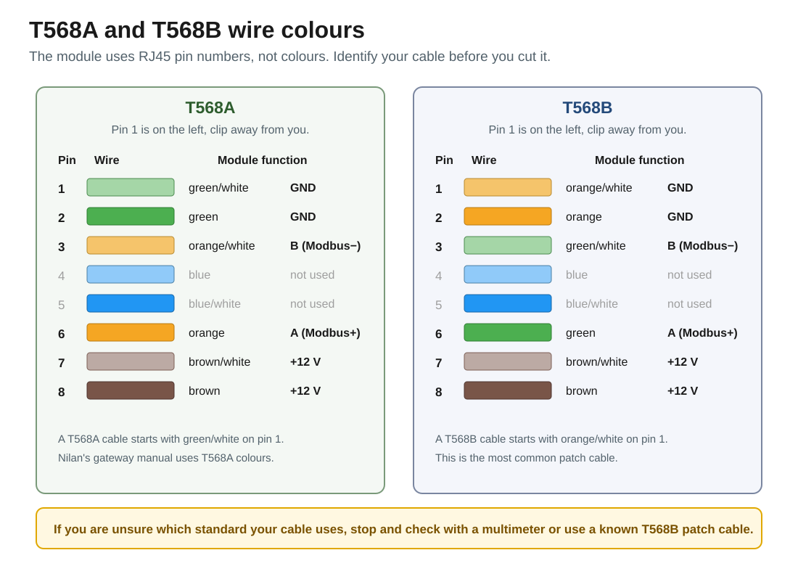
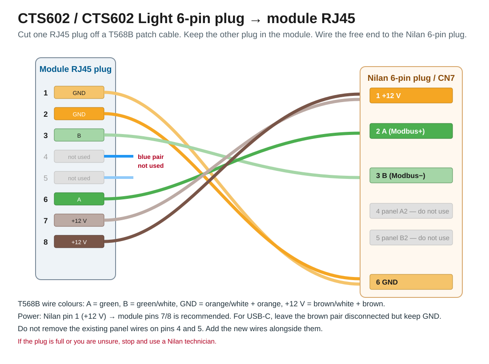
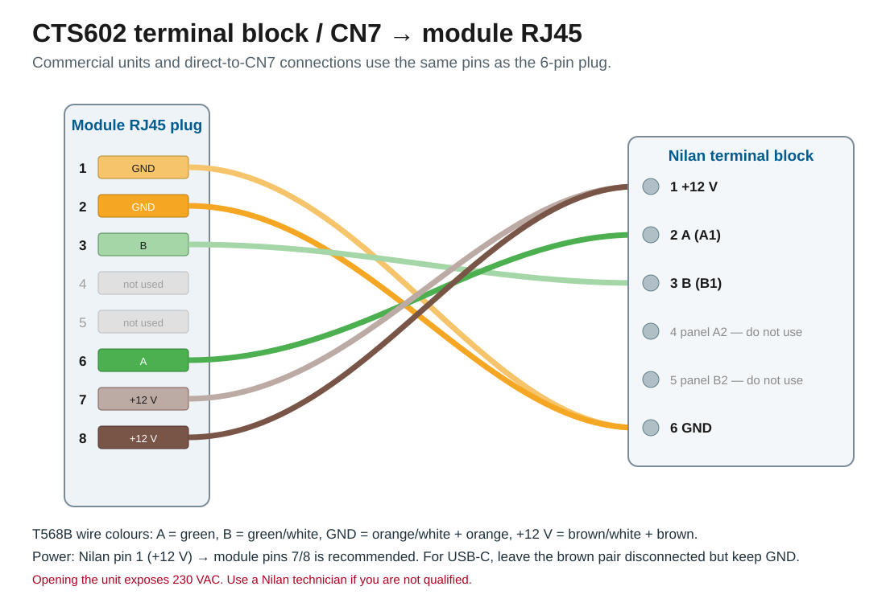
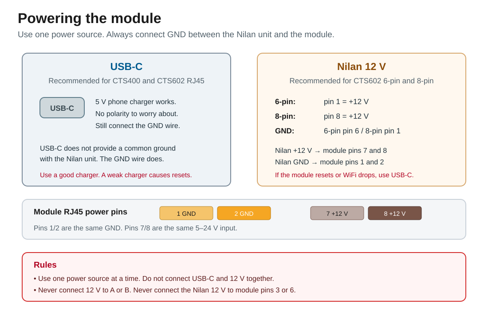
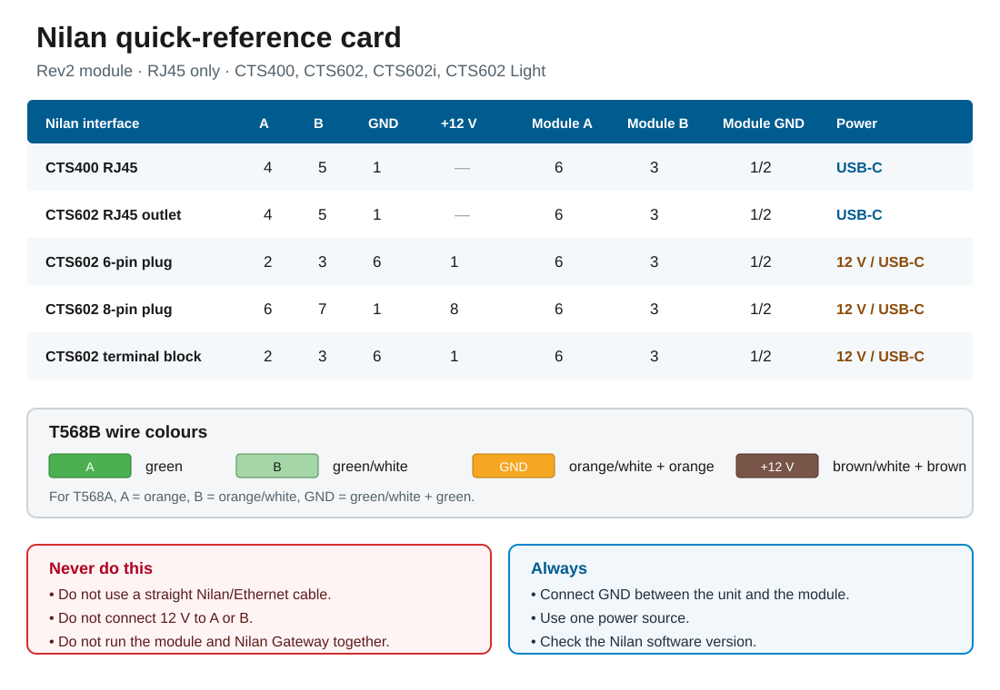

# Connecting a Nilan unit to the ESP32 Modbus module (Rev2)

This guide is for the **Rev2 module**: one RJ45 socket, one USB-C socket, and no pin header. It covers **CTS400**, **CTS602**, **CTS602i** and **CTS602 Light**.

> **Warning:** The Nilan unit contains 230 VAC. Disconnect the mains supply before you open the unit or work near its control board. If you are unsure, stop and use a Nilan technician.

> **The one thing to know:** the module's RJ45 socket is **not** a Nilan pinout and **not** a normal Ethernet pinout. It is wired for Wavin. A straight patch cable from a Nilan RJ45 port will **not work**. You must make the cable in this guide.

> **The module is a Modbus master.** Unplug the Nilan MB Gateway before you connect the module. Never run both as masters on the same bus.

### The 30-second version

1. Find your connector below.
2. Follow the matching recipe.
3. Connect GND between the Nilan unit and the module.
4. Power with USB-C, or with Nilan 12 V on the 6-pin, 8-pin or terminal-block connector.
5. Flash the ready-made YAML file for your unit.

---

## Find your connection

| Your Nilan unit has... | Use |
|---|---|
| CTS400 with an RJ45 socket | [Recipe A](#recipe-a-cts400-rj45) |
| CTS602 with an RJ45 outlet | [Recipe B](#recipe-b-cts602-rj45-outlet) |
| CTS602 / CTS602 Light with a 6-pin plug | [Recipe C](#recipe-c-cts602--cts602-light-6-pin-plug) |
| CTS602 with an 8-pin plug | [Recipe D](#recipe-d-cts602-8-pin-plug) |
| CTS602 commercial unit with a terminal block | [Recipe E](#recipe-e-cts602-terminal-block) |
| Anything else | Stop. Use a Nilan technician. |

> Do not guess. The side connectors also carry the control panel and 12 V. Connecting the wrong wire can damage the module or the unit. Take a photo of the connector before you change anything.

---

## What you need

- One **T568B** Cat5/Cat6 patch cable
- RJ45 crimping tool and two RJ45 plugs (for the CTS400/CTS602 RJ45 recipes)
- Side cutters and wire strippers
- A multimeter
- A small screwdriver
- Small Wago connectors (optional, for joining wires)
- A USB-C charger

---

## The module's RJ45

| Pin | Function | T568B wire |
|---|---|---|
| 1 | GND | orange/white |
| 2 | GND | orange |
| 3 | B (Modbus−) | green/white |
| 4 | not used | blue |
| 5 | not used | blue/white |
| 6 | A (Modbus+) | green |
| 7 | +12 V input | brown/white |
| 8 | +12 V input | brown |

- Pins 1 and 2 are the same GND. One wire is enough; two is better.
- Pins 7 and 8 are the same +12 V input. One wire is enough; two is better.
- Pins 4 and 5 are not Modbus. Leave them unconnected.
- Power with **USB-C** or **5–24 V DC** on pins 7/8. Do not use both at the same time.
- The module has an onboard **120 Ω** termination resistor.
- Older documentation calls the socket **"RJ45 B"**. That is a Wavin name, not the T568B cable standard.

---

## The Nilan RJ45

The CTS400 socket, the CTS602 RJ45 outlet, and the **Modbus port of the Nilan MB Gateway** use the same Nilan pinout:

| Nilan RJ45 pin | Function |
|---|---|
| 1 | GND |
| 4 | A (Modbus+) |
| 5 | B (Modbus−) |

Nilan's own gateway cable is normally **T568A**. In Nilan's drawings that means blue = A, blue/white = B, green/white = GND. **Do not copy those colours to the module.** Use the pin numbers in this guide.2

---

## Wire colours

The module uses **pin numbers**, not colours. Use this table for every recipe:

| Function | Module pin | T568B wire | T568A wire |
|---|---|---|---|
| A (Modbus+) | 6 | green | orange |
| B (Modbus−) | 3 | green/white | orange/white |
| GND | 1 and 2 | orange/white + orange | green/white + green |
| +12 V | 7 and 8 | brown/white + brown | brown/white + brown |
| not used | 4, 5 | blue pair | blue pair |

This guide uses **T568B** in the recipes. If your cable is T568A, use the T568A column instead.

> If a Nilan pin only accepts one wire, join the two GND wires and the two +12 V wires with a Wago first.

---

## Recipe A: CTS400 RJ45

Nilan: **4 = A, 5 = B, 1 = GND**.

### Make the cable

1. Cut **one** plug off a T568B patch cable. Keep the other plug for the module. Strip about 1 cm of insulation from the wires before crimping.
2. Crimp a new plug on the cut end with this order:

| Nilan plug pin | Wire |
|---|---|
| 1 | orange/white |
| 2 | not connected |
| 3 | not connected |
| 4 | green |
| 5 | green/white |
| 6, 7, 8 | not connected |

3. Cut the unused wires short so they cannot touch anything.
4. Plug the new end into the CTS400 socket.
5. Plug the other end into the module.

> This is **not** a standard Ethernet crossover cable. It is a custom pin mapping. A normal patch cable will not work.

**T568A cable?** Use pin 1 = green/white, pin 4 = orange, pin 5 = orange/white; leave the rest unconnected.

**Power:** USB-C. The CTS400 Modbus socket does not provide 12 V. You must still connect the GND wire.

**Firmware:** `nilan_ventilation_auto.yaml` (recommended) or the legacy `Nilan_cts400.yaml`.

---

## Recipe B: CTS602 RJ45 outlet

This uses the **same cable as Recipe A**.

| Nilan RJ45 | Function | Module RJ45 |
|---|---|---|
| 4 | A | 6 |
| 5 | B | 3 |
| 1 | GND | 1 and 2 |

**Power:** USB-C, with GND still connected. Do not assume the outlet provides 12 V.

**Firmware:** `nilan_ventilation_auto.yaml`.

---

## Recipe C: CTS602 / CTS602 Light 6-pin plug

This is the 6-pin side plug, or the CN7 connector on the control board. Pin 1 is marked on the plug.

| Nilan pin | Function |
|---|---|
| 1 | +12 V DC output |
| 2 | A (Modbus+) / COM1 A1 |
| 3 | B (Modbus−) / COM1 B1 |
| 4 | User panel A2 — do not use |
| 5 | User panel B2 — do not use |
| 6 | GND |

### Wire the cut cable

Cut one plug off a T568B patch cable. Keep the other plug in the module. Strip the ends of the wires you need.

| Nilan pin | Function | Module pin | T568B wire |
|---|---|---|---|
| 2 | A | 6 | green |
| 3 | B | 3 | green/white |
| 6 | GND | 1 and 2 | orange/white + orange |
| 1 | +12 V | 7 and 8 | brown/white + brown |

The blue pair is not used. If the Nilan plug has no free terminals, stop and use a Nilan technician.

**Power:** Nilan 12 V is recommended. Connect Nilan pin 1 to module pins 7/8, and Nilan pin 6 to module pins 1/2.

If you prefer USB-C, leave the brown pair unconnected but **still connect GND**.

> **Warning:** Pins 4 and 5 are the control panel. Do not remove or move the existing panel wires. Add the new wires alongside them.

> If the module resets or WiFi drops when the unit starts, the Nilan 12 V output may be too weak. Use USB-C instead.

**Firmware:** `nilan_ventilation_auto.yaml`.

---

## Recipe D: CTS602 8-pin plug

Some CTS602 units use an 8-pin plug for the control panel. The Modbus wires share this plug.

| Nilan pin | Function |
|---|---|
| 1 | GND |
| 2 | Panel B2 — do not use |
| 3 | Panel A2 — do not use |
| 4 | BrugerValg — do not use |
| 5 | BrugerValg — do not use |
| 6 | A (Modbus+) / A1 |
| 7 | B (Modbus−) / B1 |
| 8 | +12 V DC output |

### Wire the cut cable

Cut one plug off a T568B patch cable. Keep the other plug in the module. Strip the ends of the wires you need.

| Nilan pin | Function | Module pin | T568B wire |
|---|---|---|---|
| 6 | A | 6 | green |
| 7 | B | 3 | green/white |
| 1 | GND | 1 and 2 | orange/white + orange |
| 8 | +12 V | 7 and 8 | brown/white + brown |

The blue pair is not used. If the Nilan plug has no free terminals, stop and use a Nilan technician.

**Power:** Nilan 12 V is recommended. Connect Nilan pin 8 to module pins 7/8, and Nilan pin 1 to module pins 1/2.

If you prefer USB-C, leave the brown pair unconnected but **still connect GND**.

> **Warning:** This plug also carries the control panel. Add the new wires alongside the existing wires. Do not disconnect the panel.

**Firmware:** `nilan_ventilation_auto.yaml`.

---

## Recipe E: CTS602 terminal block

Some commercial units have a terminal box, and some technicians connect directly to CN7 on the control board.

The pins are the same as Recipe C:

| Nilan pin | Function | Module pin | T568B wire |
|---|---|---|---|
| 2 | A (A1) | 6 | green |
| 3 | B (B1) | 3 | green/white |
| 6 | GND | 1 and 2 | orange/white + orange |
| 1 | +12 V | 7 and 8 | brown/white + brown |

**Power:** Nilan 12 V recommended; USB-C alternative with GND still connected.

> **Warning:** Opening the unit exposes 230 VAC. If the terminals are full, or you are not qualified, use a Nilan technician.

**Firmware:** `nilan_ventilation_auto.yaml`.

---

## Power

| Unit | Recommended | Alternative |
|---|---|---|
| CTS400 RJ45 | USB-C | — |
| CTS602 RJ45 outlet | USB-C | — |
| CTS602 6-pin | Nilan pin 1 → module 7/8 | USB-C |
| CTS602 8-pin | Nilan pin 8 → module 7/8 | USB-C |
| CTS602 terminal block | Nilan pin 1 → module 7/8 | USB-C |

- Use **one** power source at a time.
- Never connect 12 V to A or B.
- Always connect **GND** between the unit and the module, even with USB-C.
- If the module behaves strangely, use USB-C and a good 5 V charger.

---

## Cable and termination

- Use one **twisted pair** for A/B. In a T568B cable that is the green pair.
- Keep the cable short. Nilan specifies a maximum of **20 m**.
- The module has **120 Ω** termination. Do not add another resistor at the module end.
- For a long bus or unstable communication, a 120 Ω resistor may be needed at the Nilan end. Ask a technician.
- A shielded cable is not required for the short Nilan connection.

---

## Before you power on

1. The Nilan Gateway is unplugged.
2. GND is connected between the unit and the module.
3. 12 V is **not** connected to A or B.
4. Module pins 4 and 5 are not connected to anything.
5. The cable is fully seated in the module and the Nilan connector.

After power on, look at the ESPHome log. If you see no response, swap A and B.

---

## Troubleshooting

| Symptom | Likely cause |
|---|---|
| No communication at all | Straight RJ45 cable, or wrong pinout |
| No communication after a cable change | A and B swapped |
| Works only when touching the cable | Missing GND or a bad crimp |
| Module reboots when the unit starts | Nilan 12 V too weak; use USB-C |
| Nothing on the bus | Nilan Gateway still connected |
| Wrong values | Wrong YAML file or unit software too old |

Also check:

- Baud rate, parity and address. Default is **19200 8E1, address 30**.
- The unit's software version against the table below.
- That the Nilan Gateway is not also connected.

---

## Reference

You do not need this section to wire the module.

### Supported units

Nilan's MB Gateway compatibility table is a good guide for the minimum software version:

| Unit type | CTS400 | CTS602 / CTS602i | CTS602 / CTS602i | CTS602 Light |
|---|---|---|---|---|
| All Comfort residential | SW 1.0+ | SW 2.24+ | SW 1.6.6.0+ | SW 1.1.15.0+ |
| Other residential with heat pump | — | SW 2.38r+ | SW 1.6.45.0+ | — |
| Comfort commercial | — | SW 2.38r+ | SW 1.6.45.0+ | — |
| VPM/VPL commercial | — | SW 2.38r+ | SW 1.6.45.0+ | — |
| VPR commercial | — | SW 2.38r+ | SW 1.6.45.0+ | — |

> Nilan lists two CTS602/CTS602i columns for different controller/panel generations. Match the column to your unit's software version.

If the unit is older, it may need a software update from a Nilan technician.

---

### Files and sources

Ready-made ESPHome files:

- `esphome_example_code/rev2/nilan_ventilation_auto.yaml`
- `esphome_example_code/rev2/Nilan_cts400.yaml` (legacy manual register list)

Nilan documentation:

- [Nilan downloads](https://www.nilan.dk/downloads)
- [MB Gateway LAN manual](https://www.nilan.dk/Files/Files/Dansk/Downloads/3.%20Montagevejledninger/MB%20Gateway%20LAN%20DK.pdf)
- [CTS400 Modbus protocol](https://www.nilan.dk/Files/Files/Dansk/Downloads/7.%20Modbus%20-%20BACnet/Modbus%20Protocol%20description%20-%20CTS400_GB.pdf)
- [CTS602 Light Modbus protocol](https://www.nilan.dk/Files/Files/Dansk/Downloads/7.%20Modbus%20-%20BACnet/2019_03_Modbus_CTS602Light_Modbus.pdf)
- [CTS602 with HMI350T Modbus protocol](https://www.nilan.dk/Files/Files/Dansk/Downloads/7.%20Modbus%20-%20BACnet/CTS602_w_HMI350T_Modbus.pdf)

For the connector location and pin 1 on your exact model, see the unit's electrical diagram under **"6. El-diagrammer"** in the Nilan downloads.

---

### Printable cheat sheet

| Nilan interface | Nilan A | Nilan B | Nilan GND | Nilan +12 V | Module A | Module B | Module GND | Module +12 V |
|---|---|---|---|---|---|---|---|---|
| CTS400 RJ45 | 4 | 5 | 1 | — | 6 | 3 | 1/2 | — |
| CTS602 RJ45 outlet | 4 | 5 | 1 | — | 6 | 3 | 1/2 | — |
| CTS602 6-pin | 2 | 3 | 6 | 1 | 6 | 3 | 1/2 | 7/8 |
| CTS602 8-pin | 6 | 7 | 1 | 8 | 6 | 3 | 1/2 | 7/8 |
| CTS602 terminal block | 2 | 3 | 6 | 1 | 6 | 3 | 1/2 | 7/8 |

With a **T568B** cable: A = green, B = green/white, GND = orange/white + orange, +12 V = brown/white + brown.
